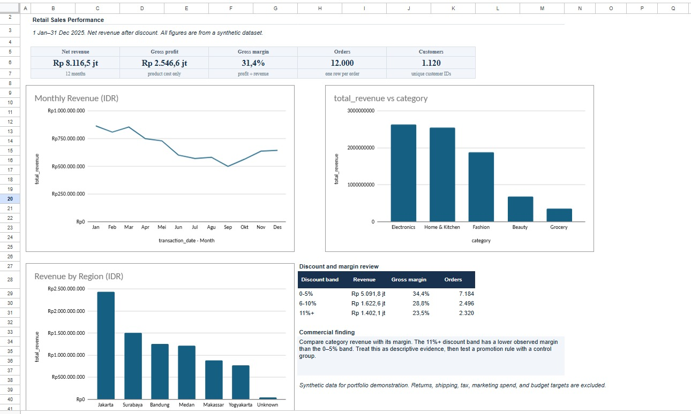

# Retail Sales Performance

A business intelligence portfolio project analyzing 12,000 synthetic retail transactions from January to December 2025. The project explores revenue trends, product category performance, regional sales, and discount levels using Google Sheets.

## Google Sheets dashboard

[Open the Retail Sales Performance dashboard](https://docs.google.com/spreadsheets/d/1eU12thTHBoSib5GSUxLqdRfHwnuvQaoFXN1Xa4qLtiI/edit?usp=sharing)

The dashboard was created manually in Google Sheets using the cleaned transaction data. It includes KPI cards for net revenue, gross profit, gross margin, orders, and customers, plus:

- **Monthly revenue** — a line chart from January to December.
- **Revenue by category** — a bar chart ordered from highest to lowest.
- **Revenue by region** — a bar chart ordered from highest to lowest.
- **Discount and margin review** — a summary of revenue, gross margin, and orders by discount band.



## Business questions

- How did revenue change month to month in 2025?
- Which product categories and regions generated the most revenue?
- How did gross margin vary across product categories and discount bands?

## Key findings

- Total revenue was **Rp8.12 billion** across 12,000 transactions.
- **Electronics** generated the most revenue by category at approximately **Rp2.64 billion**, with a gross margin of about **20.4%**.
- **Jakarta** generated the most revenue by region at approximately **Rp2.44 billion**.
- Monthly revenue was highest in **January** at approximately **Rp865.7 million** and lowest in **September** at approximately **Rp500.2 million**.
- Revenue in the second half of the year was approximately **24.1% lower** than in the first half.
- The **0–5% discount band** had an observed gross margin of approximately **34.4%**, compared with **23.5%** for discounts of 11% or more. This is descriptive and does not prove that discounts caused the margin difference.

## Data and methodology

The dataset is **synthetic**, created for portfolio practice. It contains no real customer records and was not taken from an external retail dataset.

- The raw dataset contains 12,132 rows.
- 120 duplicate transaction IDs and 12 transactions with invalid quantities were removed.
- 60 missing region values were labeled `Unknown`.
- Category and region labels were normalized.
- `total_revenue` is sales after discount.
- `profit` is calculated as `total_revenue - total_cost`.
- `gross_margin` is calculated as `profit / total_revenue`.

The dashboard uses `data/transaksi_retail_clean.csv`, which contains 12,000 transactions.

## Files

| Path | Description |
| --- | --- |
| `dashboard-preview.png` | Screenshot of the Google Sheets dashboard |
| `data/transaksi_retail_raw.csv` | Synthetic transaction data before cleaning |
| `data/transaksi_retail_clean.csv` | Cleaned transaction data used in the dashboard and analysis |
| `data/dictionary.md` | Definitions for the dataset columns |
| `data/summary.json` | Project metrics and grouped summaries |
| `scripts/analyze.py` | Python script that rebuilds the core summary from the cleaned CSV |
| `sql/analysis.sql` | SQL queries for retail sales analysis |

## Rebuild the Python summary

Python is optional for viewing the dashboard. To rebuild `data/analysis_summary_rebuilt.json`, run this command from the project folder:

```bash
python scripts/analyze.py
```

The script uses only Python's standard library.

## Data validation

The cleaned data should produce these totals:

- Transactions: **12,000**
- Revenue: **Rp8,116,548,300**
- Profit: **Rp2,546,591,300**

## Limitations

- The data is synthetic and does not represent an actual company or market.
- The analysis describes patterns in the generated dataset; it does not establish why revenue changed.
- The discount comparison is observational and does not show that discounts caused a change in revenue or margin.
- Missing region values remain visible as `Unknown` so the data quality issue is transparent.
